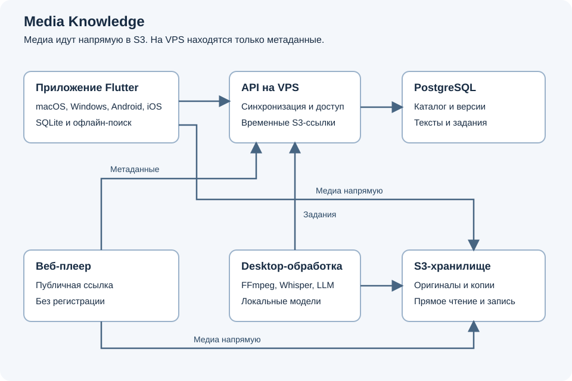

# Архитектура Media Knowledge

Media Knowledge объединяет личные аудио и видео, временные метки, фрагменты,
заметки и транскрипции. Пользователь находит нужное объяснение, открывает его
в записи и при необходимости задаёт вопрос локальной модели. Публикация по ссылке
позволяет показать выбранный материал в браузере без установки приложения.

## Требования и границы

Начальная библиотека содержит до 100 записей и пополняется постепенно. Основной
язык материалов русский. Количество записей не ограничивает длительность и размер
библиотеки, поэтому бюджет хранения и время обработки считаются по байтам и часам.

Нужны приложения для macOS, Windows, Android и iOS, быстрый переход по тайм-кодам,
создание фрагментов, поиск без интернета и экономное использование RAM и диска.
Слабый Android определяет базовый профиль воспроизведения. Точная модель телефона
и минимальные версии ОС пока не определены.

Медиа хранятся в Yandex Object Storage с S3 API. VPS хранит метаданные и управляет
синхронизацией. На нём нет исходных записей, копий для просмотра, аудиодорожек для
распознавания и экспортов, даже во временных файлах. Передача медиа через VPS
не используется как резервный маршрут.

Локальный ИИ выполняется на macOS и Windows. В первой версии мобильное приложение
ищет по готовым текстам, но не генерирует ответы. Просмотр опубликованных материалов
работает при выключенном компьютере владельца, если VPS и S3 доступны.

На текущем этапе существуют требования и техническое решение. Runtime-компоненты,
облачное окружение и измерения производительности отсутствуют. Технологии ниже
предлагаются для реализации, а не описывают уже установленную систему.

## Компоненты и ответственность

| Компонент | Ответственность | Хранит |
| --- | --- | --- |
| Flutter-клиент | Библиотека, плеер, редактор, локальный поиск и очередь правок | SQLite, индекс, ограниченный кеш, офлайн-записи |
| API на VPS | Авторизация, версии метаданных, синхронизация, публикации и задания | PostgreSQL, служебные журналы без содержимого записей |
| S3 | Прямая загрузка и выдача бинарных объектов | Оригиналы, версии для просмотра, превью, экспорты |
| Desktop-обработчик | Подготовка медиа, распознавание речи, индексация и RAG | Локальные модели, временные файлы, восстановимые индексы |
| Веб-плеер | Публикации для чтения без аккаунта | Только состояние текущего просмотра и обычный кеш браузера |

Локальная база нужна для мгновенного чтения каталога и поиска без сети.
Общее подтверждённое состояние метаданных хранится на сервере. Локальные правки
могут временно опережать сервер и явно отмечаются как ожидающие синхронизации.
Базы устройств не копируются друг на друга и не синхронизируются через S3.

Такое разделение соответствует общему подходу
[offline-first](https://developer.android.com/topic/architecture/data-layer/offline-first).
Оно не означает, что видео или весь поисковый индекс обязательно находятся в RAM.

## Технологическое решение

Клиент использует Flutter и Dart. Общими остаются модель данных, синхронизация,
редактор и интерфейс библиотеки. Доступ к файлам, фоновое выполнение, защищённое
хранение токенов и плеер имеют платформенные адаптеры. Поддержку четырёх ОС
предоставляет [Flutter](https://docs.flutter.dev/platform-integration), а фактическое
поведение медиа проверяется отдельно на каждой платформе.

Основной кандидат плеера `media_kit`. Его утверждение зависит от проверки
аппаратного декодирования, HTTP Range, расхода памяти, фонового аудио и лицензий
поставляемых библиотек. SQLite с FTS5 хранит локальные тексты и поисковый индекс.

Для API предлагается один сервис на Go и PostgreSQL. Одно приложение обслуживает
владельца, синхронизацию и публичные публикации. Задания находятся в PostgreSQL,
отдельные Redis, Kafka, поисковый кластер и векторная БД в первой версии не нужны.
Модульный монолит упрощает транзакции и резервирование при небольшом объёме.

Публичный плеер предлагается как небольшое статическое приложение на TypeScript
с HTML media element и сборкой Vite. Он не обязан использовать Flutter Web:
получателю нужен лёгкий экран просмотра, без полной библиотеки и локального ИИ.

Desktop-обработчик запускается Flutter-приложением как дочерние процессы FFmpeg,
`whisper.cpp` и `llama.cpp`, с доступом через локальный адаптер. Если движку нужен
HTTP, он слушает только loopback с одноразовым секретом сессии. Публичный сервер
моделей на компьютере не поднимается.

Точные версии SDK, runtime, моделей и нативных бинарников фиксируются на этапе
проверки совместимости. Название библиотеки не заменяет проверку её поставки на iOS
и Windows, аппаратных возможностей и лицензионных требований.

## Сквозной сценарий

Пользователь выбирает запись. Клиент создаёт локальный материал и вычисляет его
характеристики, получает от API разрешение на загрузку, затем отправляет байты
непосредственно в S3. Материал доступен на другом устройстве после подтверждения
загрузки и синхронизации метаданных. Пока загрузка не завершена, интерфейс показывает
это состояние и не выдаёт запись за доступную из облака.

Компьютер получает задание, скачивает исходник прямо из S3, готовит необходимые
производные объекты и отправляет их в S3. Текстовая транскрипция и ссылки на
производные версии принимаются API только для актуальной ревизии исходника.
Синхронизация доставляет тексты на телефон, где появляется офлайн-поиск.

Тайм-коды и фрагменты привязаны к стабильной временной шкале материала.
Удаление или замена исходника не должны молча переносить их на другую запись.
Подробности описаны в [модели данных](data-and-sync.md) и
[обработке медиа](media-and-ai.md).

## Доступ владельца и получателей

В первой версии один владелец имеет несколько устройств. Публичной регистрации
нет. Начальная учётная запись создаётся административным действием на сервере.
Предлагаются пароль с Argon2id, короткая сессия доступа и ротируемый refresh-токен
устройства. Токены устройств хранятся через системное защищённое хранилище.
Утраченное устройство можно отозвать. Точные сроки сессий фиксируются в контракте
перед реализацией авторизации.

Публичная ссылка содержит случайный идентификатор с энтропией не менее 128 бит.
Она открывает отдельный снимок разрешённых материалов. Знание ссылки даёт доступ
к публикации, но не к личному каталогу, поиску владельца или API обработки.
Персональные приглашения и совместное редактирование не входят в первую версию.

Бакет закрыт. API выдаёт временные S3-ссылки на конкретный объект и операцию,
после проверки владельца либо активной публикации. Постоянные S3-ключи остаются
на сервере. Начальный проектный срок ссылки на чтение 15 минут, клиент обновляет
её при продолжении просмотра. Браузер должен уметь восстановиться после истечения
ссылки, сохранив позицию. Возможность таких ссылок описана в
[документации Object Storage](https://yandex.cloud/en/docs/storage/concepts/pre-signed-urls).

Отключение публикации прекращает выдачу новых ссылок. Уже выданные могут работать
до истечения срока. Скачанные копии отозвать невозможно. Тела заметок, транскрипций,
токены публикаций и подписанные URL не записываются в access logs.

## Почему S3 и отдельный сервер

S3 предоставляет объектные ключи, частичное чтение и управляемый браузерный доступ.
Это позволяет держать видео вне VPS и масштабировать выдачу независимо от API.
Яндекс Диск выгоден как личный файловый архив, но не выбран основным источником
для собственного плеера. Поддержка второго хранилища откладывается до реального
запроса, без универсального адаптера на будущее.

Сервер метаданных упорядочивает изменения устройств и хранит публикации. Протокол
поверх файлов на Диске потребовал бы самостоятельно решать ту же задачу, включая
конкурентные записи и восстановление пропущенных изменений.

Потоковое чтение объекта поддерживается через
[Range](https://yandex.cloud/ru/docs/storage/s3/api-ref/object/get), но не гарантирует
быструю перемотку любого исходника. Контейнер, ключевые кадры, кодек, сеть и плеер
остаются частью общего решения.

## Границы доступности

Без интернета работают локальные тексты, тайм-коды, заметки и скачанные записи.
На компьютере также работают загруженные модели и локально доступный RAG-контекст.
Новые правки остаются в очереди. Телефон не обращается к компьютеру для обычного поиска.

Если VPS недоступен, сохраняется локальная работа, но новые разрешения на S3
и публичные публикации временно недоступны. Если недоступен S3, доступны тексты
и локальный кеш. Если компьютер выключен, новые транскрипции и экспорты ожидают
обработки, а уже опубликованные записи продолжают воспроизводиться через VPS и S3.

Бесконечная скорость любой записи не является обещанием. Измеримые цели,
неизвестные параметры и условия перехода к разработке находятся в
[плане реализации](delivery.md). [Эксплуатация](operations.md) описывает стоимость,
резервирование и границы будущего развёртывания.
